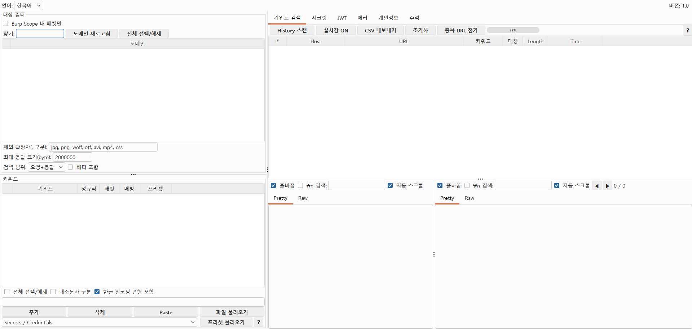
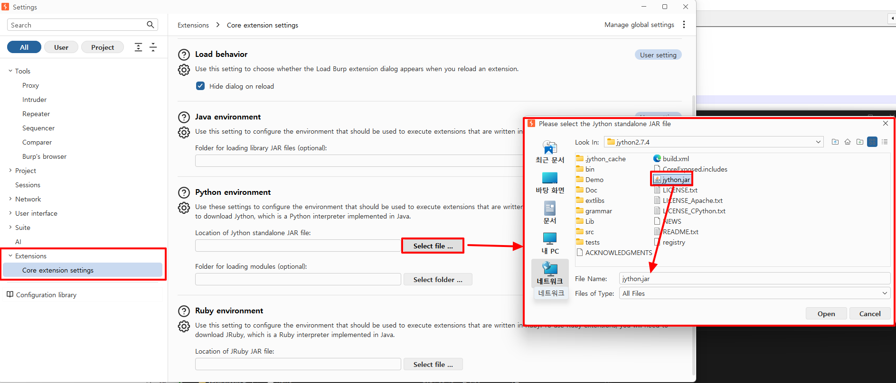
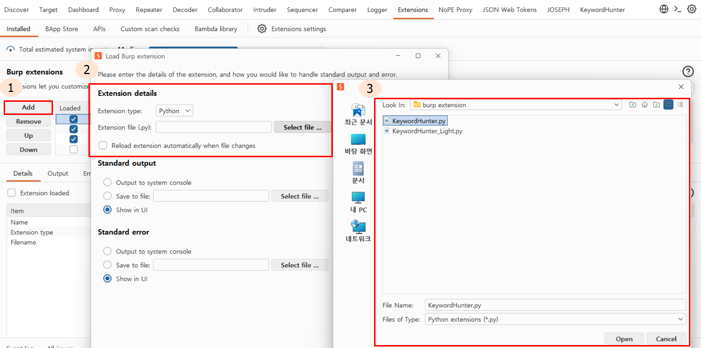
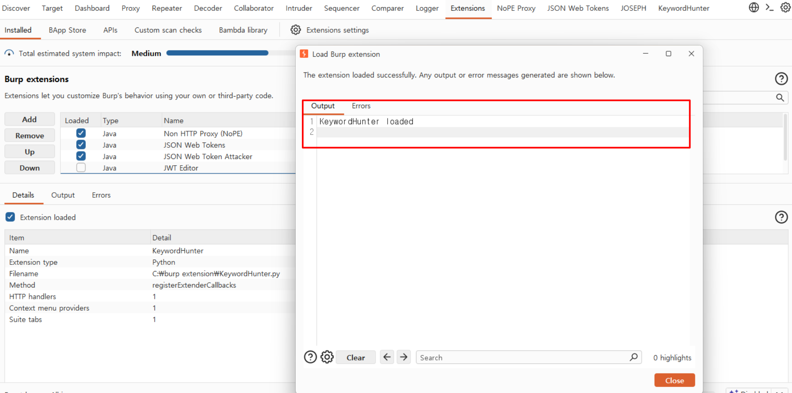
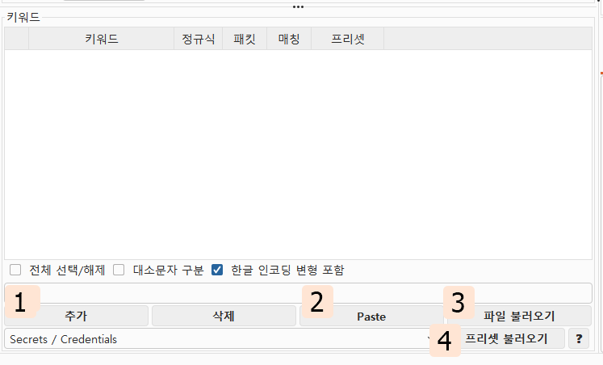
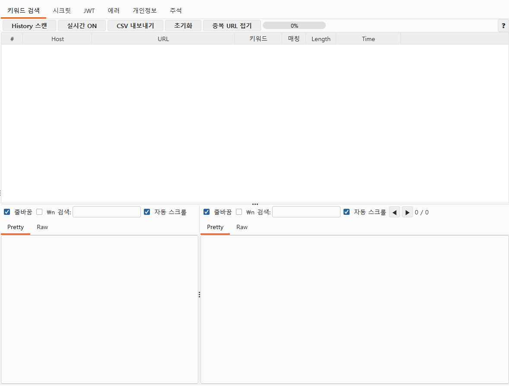

<p align="center">
  <a href="./README.md">English</a> | <b>한국어</b>
</p>

<h1 align="center">KeywordHunter</h1>

<p align="center">
  <b>Burp Suite HTTP history 속 단서를 하나도 놓치지 마세요.</b>
</p>

<p align="center">
  
  
  
  <a href="#영상-매뉴얼"></a>
  
  
</p>

<p align="center">
  
</p>

---

## 목차

1. [이중 언어 지원](#이중-언어-지원)
2. [왜 KeywordHunter인가?](#왜-keywordhunter인가)
3. [주요 기능](#주요-기능)
4. [빠른 시작](#빠른-시작)
5. [키워드 추가 방법](#키워드-추가-방법)
   - [방법 1. 직접 입력하기](#방법-1-직접-입력하기)
   - [방법 2. 목록 붙여넣기](#방법-2-목록-붙여넣기)
   - [방법 3. 파일 불러오기](#방법-3-파일-불러오기)
   - [방법 4. 프리셋 불러오기](#방법-4-프리셋-불러오기)
6. [탐지 탭](#탐지-탭)
7. [동작 원리](#동작-원리)
8. [영상 매뉴얼](#영상-매뉴얼)
9. [Full vs Light](#full-vs-light)
10. [라이선스](#라이선스)
11. [감사의 말](#감사의-말)

---

## 이중 언어 지원

KeywordHunter는 문서와 영상 매뉴얼은 물론 **익스텐션 화면까지 영어와 한국어**로 제공합니다. 누구나 가장 편한 언어로 사용할 수 있습니다.

| | English | 한국어 |
|---|---|---|
| README | [README.md](./README.md) | 현재 문서 |
| 영상 매뉴얼 | [Watch in English](https://www.youtube.com/watch?v=t-YlHQaeYWs) | [한국어로 보기](https://www.youtube.com/watch?v=I1scY24E2AU) |
| 익스텐션 화면 | Switch with the **Language** menu | **언어** 메뉴에서 전환 |

---

## 왜 KeywordHunter인가?

웹 해킹에서 취약점은 눈에 띄는 버그 하나로 발견되기보다, 수많은 패킷 속에 흩어진 작은 단서들을 조합해서 발견되는 경우가 많습니다. JavaScript 파일 깊숙이 숨어 있는 내부 API 경로, 응답에 섞여 있는 토큰, 상세한 에러 메시지, 개발자가 미처 지우지 못한 주석처럼 하나씩 보면 사소해 보이는 정보들이 모였을 때 실제 취약점으로 이어집니다.

문제는 양입니다. 진단을 하다 보면 워낙 많은 패킷을 확인하게 되고, 숙련된 진단자라도 사람이기 때문에 중요한 단서를 실수로 놓치는 순간이 생깁니다. 단서 하나를 놓치면 취약점 하나를 놓칠 수 있습니다.

**KeywordHunter는 바로 이 빈틈을 메우기 위해 만들었습니다.** Burp HTTP history 전체에서 원하는 키워드를 검색하고, 민감한 패턴을 탭별로 자동 분류하며, 단서가 발견된 요청으로 바로 이동할 수 있게 해줍니다. 중요한 정보가 수많은 패킷 속에 묻히지 않도록 말이죠.

---

## 주요 기능

- **한국어·영어 화면** — 익스텐션 전체를 언제든 한국어와 영어로 전환할 수 있습니다.
- **대상 필터** — Burp Scope, 선택한 도메인, 제외 확장자, 최대 응답 크기, 검색 범위(요청·응답·둘 다, 헤더 포함 여부)로 대상을 좁힐 수 있습니다.
- **유연한 키워드** — 일반 문자열과 정규식, 대소문자 구분 옵션, 프리셋 7종을 지원하며 키워드 목록은 자동으로 저장됩니다.
- **한글 검색 지원** — 한글 키워드 하나로 유니코드 이스케이프, URL 인코딩(UTF-8·MS949), HTML 엔티티 형태까지 함께 찾습니다.
- **두 가지 스캔 방식** — 기존 history를 진행률과 함께 백그라운드로 스캔하거나, 실시간 모드로 새로 들어오는 트래픽을 바로 검사하고 새 결과를 강조 표시합니다.
- **내장 뷰어** — 요청·응답을 Pretty/Raw로 보여주고, 일치한 부분을 강조하며 이전/다음으로 이동할 수 있습니다.
- **탐지 탭 5종** — Secrets, JWT, Errors, PII, Comments를 자동으로 수집합니다(Full 버전).
- **작업 편의 기능** — Send to Repeater(우클릭 또는 `Ctrl+R`), CSV 내보내기, 중복 URL 접기, 탭마다 도움말 버튼을 제공합니다.

---

## 빠른 시작

### 1단계. Jython 다운로드 (필수)

KeywordHunter는 Python으로 작성되어 있어서, Burp Suite에서 실행하려면 **Jython standalone JAR**가 필요합니다.

**[Jython standalone JAR 다운로드](https://www.jython.org/download)** — `jython-standalone-2.7.x.jar`를 받으세요.

> [!IMPORTANT]
> 설치 프로그램(installer)이 아니라 **standalone** JAR를 받아야 합니다.

### 2단계. Burp Suite에 Jython 경로 설정

[영상에서 이 부분 보기 (00:23)](https://www.youtube.com/watch?v=I1scY24E2AU&t=23s)

1. Burp Suite에서 **Settings** > **Extensions**로 이동합니다.
2. **Python environment** 항목의 *Location of Jython standalone JAR file* 옆 **Select file...**을 클릭합니다.
3. 다운로드한 `jython-standalone-2.7.x.jar`를 선택합니다.

<p align="center">
  
</p>

### 3단계. KeywordHunter 다운로드

[Releases](https://github.com/windbreaker-jacket/KeywordHunter/releases) 페이지에서 최신 버전을 받으세요.

| 버전 | 파일 | 설명 |
|---|---|---|
| Full | `KeywordHunter.py` | 키워드 검색 + 모든 탐지 탭 |
| Light | `KeywordHunter_Light.py` | 키워드 검색만 있는 가벼운 버전 |

### 4단계. 익스텐션 추가

[영상에서 이 부분 보기 (00:38)](https://www.youtube.com/watch?v=I1scY24E2AU&t=38s)

1. **Extensions** > **Installed**에서 **Add**를 클릭합니다.
2. **Extension type**을 **Python**으로 선택합니다.
3. **Select file...**을 눌러 `KeywordHunter.py`를 선택합니다.
4. **Next**를 누르면 Burp 상단 메뉴에 **KeywordHunter** 탭이 생깁니다(Light 버전은 **KeywordHunter Light**).

<p align="center">
  
</p>

<p align="center">
  
</p>

> [!TIP]
> 익스텐션이 로드되지 않으면 추가 화면의 **Errors** 탭을 확인하고, 2단계의 Jython 경로가 올바르게 설정됐는지 확인하세요.

---

## 키워드 추가 방법

KeywordHunter는 키워드 목록을 만드는 네 가지 방법을 제공합니다. 작업 방식에 맞는 방법을 골라 사용하세요. 키워드 목록은 자동으로 저장되어 익스텐션을 다시 불러와도 그대로 유지됩니다.

[영상에서 이 부분 보기 (04:00)](https://www.youtube.com/watch?v=I1scY24E2AU&t=240s)

<p align="center">
  
</p>

### 방법 1. 직접 입력하기

키워드 하나를 가장 빠르게 추가하는 방법입니다.

1. **키워드** 패널의 입력란에 키워드를 입력합니다.
2. **추가**를 클릭하면 목록에 추가됩니다.
3. 정규식으로 검색하려면 해당 키워드의 **정규식** 열을 체크합니다.

### 방법 2. 목록 붙여넣기

메모나 다른 도구에 정리해 둔 키워드 목록이 있을 때 유용합니다.

1. 키워드를 한 줄에 하나씩 클립보드에 복사합니다.
2. **Paste**를 클릭하면 모든 줄이 한 번에 목록에 추가됩니다.

### 방법 3. 파일 불러오기

여러 진단에서 계속 쓰는 키워드 목록을 재사용할 때 좋습니다.

1. 한 줄에 키워드 하나씩 적은 텍스트 파일을 준비합니다(UTF-8 또는 MS949).
2. **파일 불러오기**를 클릭하고 파일을 선택합니다.

### 방법 4. 프리셋 불러오기

어떤 키워드부터 넣어야 할지 모르겠다면, 드롭다운에서 미리 준비된 키워드 세트를 고른 뒤 **프리셋 불러오기**를 클릭하세요. **프리셋** 열에 각 키워드의 출처가 표시됩니다.

| 프리셋 | 예시 |
|---|---|
| Secrets / Credentials | `AKIA`, `AIza`, `ghp_`, `xoxb-`, `api_key`, `access_token`, `password` |
| Config / Env Files | `.env`, `web.config`, `application.properties`, `jdbc:`, `mongodb://` |
| Debug / Dev Mistakes | `TODO`, `FIXME`, `console.log`, `var_dump`, `Fatal error` |
| Internal Hosts / IP | `10.`, `192.168.`, `172.16.`, `localhost`, `.internal` |
| Source Code Mgmt | `.git/`, `.svn/`, `.hg/`, `.bzr/` |
| Framework / Endpoints | `/actuator`, `/jolokia`, `/graphql`, `swagger`, `/api-docs` |
| Redirect / Hidden Params | `redirect`, `returnUrl`, `callback`, `next`, `redirect_uri` |

> [!NOTE]
> 각 키워드의 체크박스로 사용 여부를 켜고 끌 수 있습니다. **삭제**는 선택한 행과 체크된 행을 모두 지우므로, 남길 키워드는 체크를 해제한 뒤 삭제하세요.

---

## 탐지 탭

각 탭은 서로 다른 종류의 단서를 모아 보여줍니다. 항목을 선택하면 해당 단서가 발견된 요청과 응답 전체를 확인할 수 있습니다.

<p align="center">
  
</p>

Secrets부터 Comments까지 5개의 분석 탭은 선택한 도메인의 **응답**을 대상으로 하며, 바이너리 응답은 제외합니다. **분석 실행**으로 필요할 때 실행하거나 실시간 모드로 계속 수집할 수 있습니다.

### Keyword

키워드 목록에 있는 단어가 포함된 요청과 응답을 일치한 키워드, 매칭 수, 길이, 시각과 함께 보여줍니다. 목록에서 키워드를 클릭하면 해당 키워드의 결과만 볼 수 있고, 결과를 선택하면 요청·응답 뷰어에서 일치한 부분이 모두 강조됩니다.

[영상에서 이 부분 보기 (07:40)](https://www.youtube.com/watch?v=I1scY24E2AU&t=460s)

### Secrets

하드코딩된 시크릿을 세 가지 방식으로 찾습니다.
- **알려진 형식** — AWS 액세스 키, Google API 키, Google OAuth 클라이언트 ID, Slack 토큰과 웹훅, GitHub 토큰, 개인키, Bearer 토큰
- **하드코딩 할당** — `api_key=`, `password=`, `token=` 같은 형태의 값
- **고엔트로피 문자열** — 섀넌 엔트로피 4.2 이상인 무작위 값으로, 알려진 형식이 없는 커스텀 토큰일 수 있습니다

[영상에서 이 부분 보기 (09:26)](https://www.youtube.com/watch?v=I1scY24E2AU&t=566s)

### JWT

응답에 포함된 JSON Web Token을 찾아 header와 payload를 디코딩합니다. 각 토큰에 `alg:none` 여부, 유효·만료 여부, `role`이나 `admin` 같은 권한 클레임 존재 여부를 표시합니다.

[영상에서 이 부분 보기 (10:45)](https://www.youtube.com/watch?v=I1scY24E2AU&t=645s)

### Errors

Java, Python, Oracle, SQL, .NET, PHP의 스택트레이스와 에러 메시지를 탐지하고 주변 문맥을 함께 보여줍니다. 기술 스택, 내부 경로, 쿼리 구조가 드러나는 경우가 많습니다.

[영상에서 이 부분 보기 (11:30)](https://www.youtube.com/watch?v=I1scY24E2AU&t=690s)

### PII

응답에 평문으로 노출된 주민등록번호, 휴대폰 번호, 이메일 주소, 카드번호(Luhn 체크섬 검증)를 탐지합니다.

[영상에서 이 부분 보기 (11:58)](https://www.youtube.com/watch?v=I1scY24E2AU&t=718s)

### Comments

개발자가 메모, 내부 경로, 테스트 코드를 남기기 쉬운 HTML 주석(`<!-- -->`)을 모아 보여줍니다. IE 조건부 주석은 제외하며, 중복 주석은 접어서 볼 수 있습니다.

[영상에서 이 부분 보기 (12:18)](https://www.youtube.com/watch?v=I1scY24E2AU&t=738s)

---

## 동작 원리

```
Proxy history / 실시간 Proxy 트래픽
  -> 필터링 : Burp Scope, 선택 도메인, 제외 확장자, 최대 크기, 바이너리 판별
  -> 디코딩 : charset 자동 판별(헤더 / <meta>), UTF-8·MS949 폴백
  -> 매칭   : 키워드, 정규식, 한글 인코딩 변형 / 탭별 탐지 엔진
  -> 표시   : 백그라운드 스캔과 진행률, 중복 접기, 새 항목 강조
```

- **두 가지 수집 방식** — 기존 트래픽은 `getProxyHistory()`로 일괄 스캔하고, 새 트래픽은 `IHttpListener`로 실시간 검사합니다. 실시간 검사는 도메인을 하나 이상 선택했을 때만 동작합니다.
- **오탐을 줄이는 설계** — Content-Type, 파일 시그니처, 출력 불가 바이트 비율로 PDF·이미지·압축·폰트 같은 바이너리 응답을 제외하고, 카드번호는 Luhn 체크섬으로 검증하며, 알 수 없는 토큰은 섀넌 엔트로피 4.2 이상일 때만 탐지합니다.
- **한국 환경 지원** — EUC-KR·MS949 페이지를 자동으로 판별하고, 한글 키워드 하나로 `\uXXXX`, URL 인코딩(UTF-8·MS949), HTML 엔티티 형태까지 함께 검색합니다.
- **멈추지 않는 화면** — 스캔은 백그라운드 스레드에서 실행되고 화면은 `SwingUtilities.invokeLater`로 갱신되어, history가 많아도 Burp가 멈추지 않습니다.
- **설정 유지** — 키워드 목록은 Burp의 `saveExtensionSetting`으로 저장되고 익스텐션을 불러올 때 복원됩니다.

---

## 영상 매뉴얼

모든 기능을 소개하는 전체 영상을 **한국어와 영어 두 버전**으로 제공합니다.

<table>
  <tr>
    <td align="center" width="50%">
      <a href="https://www.youtube.com/watch?v=I1scY24E2AU"></a>
      <br><b>한국어</b>
    </td>
    <td align="center" width="50%">
      <a href="https://www.youtube.com/watch?v=t-YlHQaeYWs"></a>
      <br><b>English</b>
    </td>
  </tr>
</table>

---

## Full vs Light

**KeywordHunter Light**는 키워드 검색 기능은 모두 그대로 두고 분석 탭 5개만 뺀 버전입니다. 더 단순한 도구를 원하는 분께 추천합니다.

[영상에서 이 부분 보기 (13:24)](https://www.youtube.com/watch?v=I1scY24E2AU&t=804s)

| 기능 | Full | Light |
|---|:-:|:-:|
| 키워드 검색 (필터, 정규식, 한글 인코딩 변형, 프리셋) | O | O |
| 실시간 모드, CSV 내보내기, Send to Repeater | O | O |
| 한국어·영어 화면 | O | O |
| 탐지 탭 (Secrets, JWT, Errors, PII, Comments) | O | - |

---

## 라이선스

MIT License로 배포됩니다. 자세한 내용은 [`LICENSE`](./LICENSE)를 참고하세요.

---

## 감사의 말

약 두 달 동안 실제 진단 업무에서 이 익스텐션을 직접 사용하며 버그 제보부터 추가 기능들까지 솔직하고 꼼꼼한 피드백을 아끼지 않은 회사 동료들에게 진심으로 감사드립니다.

---

## 만든 사람

**windbreaker-jacket** — Penetration Tester
[GitHub](https://github.com/windbreaker-jacket)

<p align="right"><a href="#목차">맨 위로</a></p>