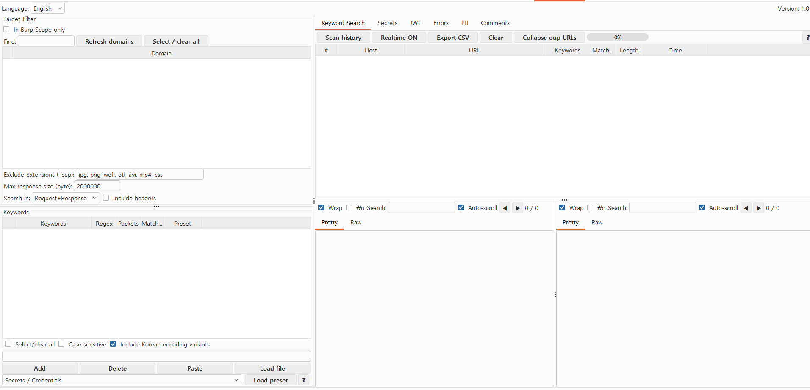
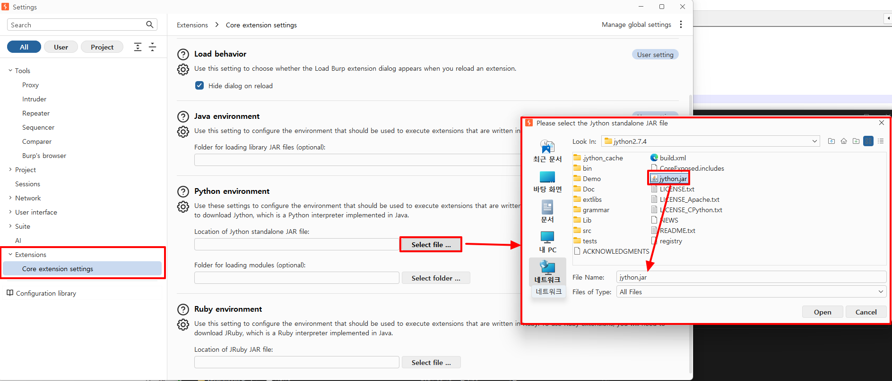
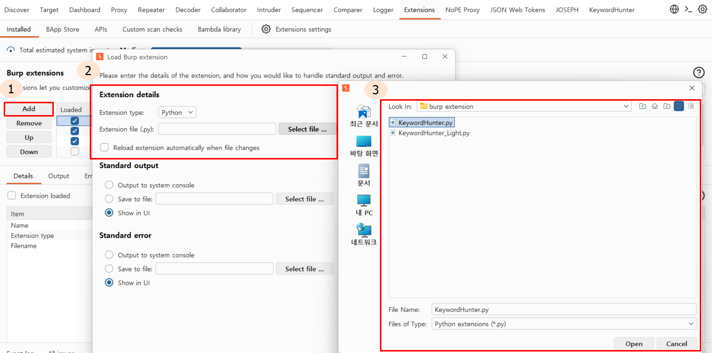
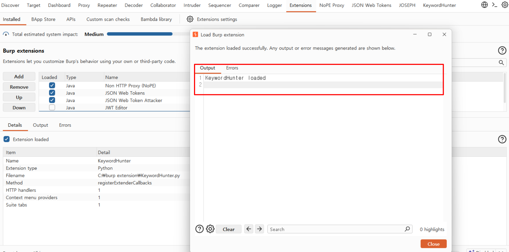
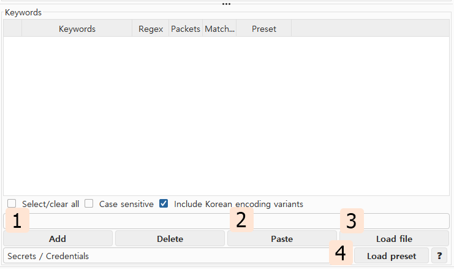
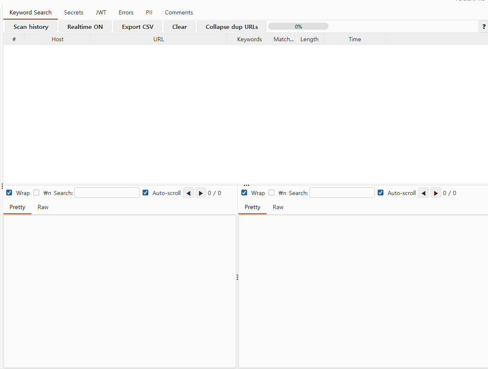

<p align="center">
  <b>English</b> | <a href="./README.ko.md">한국어</a>
</p>

<h1 align="center">KeywordHunter</h1>

<p align="center">
  <b>Never miss a clue hidden in your Burp Suite HTTP history.</b>
</p>

<p align="center">
  
  
  
  <a href="#video-manual"></a>
  
  
</p>

<p align="center">
  
</p>

---

## Table of Contents

1. [Bilingual Documentation](#bilingual-documentation)
2. [Why KeywordHunter?](#why-keywordhunter)
3. [Features](#features)
4. [Quick Start](#quick-start)
5. [How to Add Keywords](#how-to-add-keywords)
   - [Method 1. Type a Keyword](#method-1-type-a-keyword)
   - [Method 2. Paste a Keyword List](#method-2-paste-a-keyword-list)
   - [Method 3. Load from File](#method-3-load-from-file)
   - [Method 4. Load a Preset](#method-4-load-a-preset)
6. [Detection Tabs](#detection-tabs)
7. [How It Works](#how-it-works)
8. [Video Manual](#video-manual)
9. [Full vs Light](#full-vs-light)
10. [License](#license)
11. [Acknowledgments](#acknowledgments)

---

## Bilingual Documentation

KeywordHunter provides its documentation, its video manual and even its own interface in **English and Korean**, so testers can work in the language they are most comfortable with.

| | English | 한국어 |
|---|---|---|
| README | You are here | [README.ko.md](./README.ko.md) |
| Video Manual | [Watch in English](https://www.youtube.com/watch?v=t-YlHQaeYWs) | [한국어로 보기](https://www.youtube.com/watch?v=I1scY24E2AU) |
| Extension UI | Switch with the **Language** menu | **언어** 메뉴에서 전환 |

---

## Why KeywordHunter?

Web application testing is rarely about a single obvious bug. More often, a vulnerability is found by connecting small clues scattered across hundreds or thousands of packets — an internal API path buried in a JavaScript bundle, a token in a response, a verbose error message, or a comment a developer forgot to remove. On their own, these details look harmless. Put together, they often lead to a real finding.

The challenge is volume. During an engagement, a tester reviews an enormous amount of traffic, and even an experienced eye can overlook a critical detail through simple human error. One missed clue can mean one missed vulnerability.

**KeywordHunter was built to close that gap.** It searches your entire Burp HTTP history for the keywords you care about, automatically sorts sensitive patterns into dedicated tabs, and takes you straight to the request where each clue was found — so the details that matter never get lost in the noise.

---

## Features

- **Bilingual interface** — switch the entire extension between Korean and English at any time.
- **Target filtering** — limit the search to Burp scope, selected domains, excluded file extensions, a maximum response size, and request, response or both (with or without headers).
- **Flexible keywords** — plain text or regex, optional case sensitivity, 7 built-in presets, and a keyword list that is saved automatically between sessions.
- **Korean-aware search** — a single Korean keyword also matches its Unicode-escaped, URL-encoded (UTF-8 and MS949) and HTML-entity forms.
- **Two scan modes** — scan the existing history in the background with a progress bar, or turn on real-time mode to inspect new proxy traffic as it arrives, with new results highlighted.
- **Built-in viewer** — Pretty and Raw views for requests and responses, with matches highlighted and previous/next navigation.
- **Five detection tabs** — Secrets, JWT, Errors, PII and Comments are collected automatically (Full version).
- **Workflow helpers** — Send to Repeater (right-click or `Ctrl+R`), CSV export, duplicate URL collapsing, and a help button on every tab.

---

## Quick Start

### Step 1. Download Jython (required)

KeywordHunter is written in Python, so Burp Suite needs the **Jython standalone JAR** to run it.

**[Download Jython standalone JAR](https://www.jython.org/download)** — choose `jython-standalone-2.7.x.jar`

> [!IMPORTANT]
> Download the **standalone** JAR, not the installer.

### Step 2. Configure Jython in Burp Suite

[Watch this part of the video (00:29)](https://www.youtube.com/watch?v=t-YlHQaeYWs&t=29s)

1. Open Burp Suite and go to **Settings** > **Extensions**
2. Under **Python environment**, click **Select file...** next to *Location of Jython standalone JAR file*
3. Select the `jython-standalone-2.7.x.jar` you downloaded

<p align="center">
  
</p>

### Step 3. Download KeywordHunter

Download the latest version from the [Releases](https://github.com/windbreaker-jacket/KeywordHunter/releases) page.

| Version | File | Description |
|---|---|---|
| Full | `KeywordHunter.py` | Keyword search with all detection tabs |
| Light | `KeywordHunter_Light.py` | Keyword search only, lightweight |

### Step 4. Load the Extension

[Watch this part of the video (00:52)](https://www.youtube.com/watch?v=t-YlHQaeYWs&t=52s)

1. Go to **Extensions** > **Installed** and click **Add**
2. Set **Extension type** to **Python**
3. Click **Select file...** and choose `KeywordHunter.py`
4. Click **Next**. The **KeywordHunter** tab will appear in Burp's top menu (**KeywordHunter Light** for the Light version).

<p align="center">
  
</p>

<p align="center">
  
</p>

> [!TIP]
> If the extension fails to load, check the **Errors** tab in the extension dialog and make sure the Jython path from Step 2 is set correctly.

---

## How to Add Keywords

KeywordHunter offers four ways to build your keyword list. Use whichever fits your workflow. Your keyword list is saved automatically and restored the next time you load the extension.

[Watch this part of the video (05:18)](https://www.youtube.com/watch?v=t-YlHQaeYWs&t=318s)

<p align="center">
  
</p>

### Method 1. Type a Keyword

The quickest way to add a single keyword.

1. Type a keyword into the input field of the **Keywords** panel.
2. Click **Add**. The keyword appears in the list.
3. To search with a regular expression, check the **Regex** column of that keyword.

### Method 2. Paste a Keyword List

Useful when you already have a list of keywords from notes or another tool.

1. Copy your keywords to the clipboard, one per line.
2. Click **Paste**. Every line is added to the list at once.

### Method 3. Load from File

Ideal for reusing a keyword list you maintain across engagements.

1. Prepare a text file with one keyword per line (UTF-8 or MS949).
2. Click **Load file** and select the file.

### Method 4. Load a Preset

Not sure where to start? Pick a ready-made keyword set from the dropdown and click **Load preset**. The **Preset** column shows where each keyword came from.

| Preset | Examples |
|---|---|
| Secrets / Credentials | `AKIA`, `AIza`, `ghp_`, `xoxb-`, `api_key`, `access_token`, `password` |
| Config / Env Files | `.env`, `web.config`, `application.properties`, `jdbc:`, `mongodb://` |
| Debug / Dev Mistakes | `TODO`, `FIXME`, `console.log`, `var_dump`, `Fatal error` |
| Internal Hosts / IP | `10.`, `192.168.`, `172.16.`, `localhost`, `.internal` |
| Source Code Mgmt | `.git/`, `.svn/`, `.hg/`, `.bzr/` |
| Framework / Endpoints | `/actuator`, `/jolokia`, `/graphql`, `swagger`, `/api-docs` |
| Redirect / Hidden Params | `redirect`, `returnUrl`, `callback`, `next`, `redirect_uri` |

> [!NOTE]
> Use the checkbox on each keyword to turn it on or off. **Delete** removes both the selected rows and all checked rows, so uncheck the keywords you want to keep before deleting.

---

## Detection Tabs

Each tab collects a different type of clue. Select any row to see the full request and response where it was found.

<p align="center">
  
</p>

The five analysis tabs (Secrets to Comments) inspect **responses** from the domains you selected, skip binary content, and can be run on demand with **Analyze** or kept running with real-time mode.

### Keyword

Lists every request and response that contains a keyword from your list, with the matched keyword, match count, length and time. Click a keyword in the list to show only its results; selecting a result highlights every match in the request and response viewers.

[Watch this part of the video (08:57)](https://www.youtube.com/watch?v=t-YlHQaeYWs&t=537s)

### Secrets

Finds hard-coded secrets in three ways:
- **Known formats** — AWS access keys, Google API keys, Google OAuth client IDs, Slack tokens and webhooks, GitHub tokens, private keys and Bearer tokens
- **Hard-coded assignments** — values such as `api_key=`, `password=`, `token=`
- **High-entropy strings** — random-looking values with a Shannon entropy of 4.2 or higher, which may be custom tokens with no known format

[Watch this part of the video (12:47)](https://www.youtube.com/watch?v=t-YlHQaeYWs&t=767s)

### JWT

Finds JSON Web Tokens in responses and decodes their header and payload. Each token is flagged for `alg:none`, whether it is valid or expired, and whether it carries privilege claims such as `role` or `admin`.

[Watch this part of the video (15:00)](https://www.youtube.com/watch?v=t-YlHQaeYWs&t=900s)

### Errors

Detects stack traces and error messages from Java, Python, Oracle, SQL, .NET and PHP, and shows the surrounding text. These often reveal the technology stack, internal paths or query structure.

[Watch this part of the video (16:59)](https://www.youtube.com/watch?v=t-YlHQaeYWs&t=1019s)

### PII

Detects Korean resident registration numbers, mobile phone numbers, email addresses and card numbers (validated with the Luhn checksum) returned in plain text.

[Watch this part of the video (16:42)](https://www.youtube.com/watch?v=t-YlHQaeYWs&t=1002s)

### Comments

Collects HTML comments (`<!-- -->`), where developers often leave notes, internal paths or test code. IE conditional comments are excluded, and duplicate comments can be collapsed.

[Watch this part of the video (17:11)](https://www.youtube.com/watch?v=t-YlHQaeYWs&t=1031s)

---

## How It Works

```
Proxy history / live proxy traffic
  -> Filter   : Burp scope, selected domains, excluded extensions, max size, binary detection
  -> Decode   : charset auto-detection (header / <meta>), UTF-8 and MS949 fallback
  -> Match    : keywords, regex, Korean encoding variants / per-tab detection engines
  -> Display  : background scanning with progress, duplicate collapsing, new-item highlighting
```

- **Two collection modes** — `getProxyHistory()` for a full scan of existing traffic, and `IHttpListener` for real-time inspection of new proxy responses, which runs only after at least one domain is selected.
- **Built to reduce false positives** — binary responses (PDF, images, archives, fonts) are skipped using the Content-Type, file signatures and the ratio of non-printable bytes; card numbers are validated with the Luhn checksum; unknown tokens are flagged only above a Shannon entropy of 4.2.
- **Korean-aware** — EUC-KR and MS949 pages are detected automatically, and a single Korean keyword also matches its `\uXXXX`, URL-encoded (UTF-8 and MS949) and HTML-entity forms.
- **Responsive UI** — scans run on a background thread and update the Swing UI through `SwingUtilities.invokeLater`, so Burp stays responsive on large histories.
- **Persistent settings** — the keyword list is stored with Burp's `saveExtensionSetting` and restored on load.

---

## Video Manual

A full walkthrough of every feature is available in **both English and Korean**.

<table>
  <tr>
    <td align="center" width="50%">
      <a href="https://www.youtube.com/watch?v=t-YlHQaeYWs"></a>
      <br><b>English</b>
    </td>
    <td align="center" width="50%">
      <a href="https://www.youtube.com/watch?v=I1scY24E2AU"></a>
      <br><b>한국어</b>
    </td>
  </tr>
</table>

---

## Full vs Light

**KeywordHunter Light** keeps every keyword search feature and removes only the five analysis tabs, for testers who prefer a simpler tool.

[Watch this part of the video (18:42)](https://www.youtube.com/watch?v=t-YlHQaeYWs&t=1122s)

| Feature | Full | Light |
|---|:-:|:-:|
| Keyword search (filters, regex, Korean encoding variants, presets) | Yes | Yes |
| Real-time mode, CSV export, Send to Repeater | Yes | Yes |
| Korean / English interface | Yes | Yes |
| Detection tabs (Secrets, JWT, Errors, PII, Comments) | Yes | - |

---

## License

Distributed under the MIT License. See [`LICENSE`](./LICENSE) for details.

---

## Acknowledgments

I sincerely thank my colleagues who used this extension in real engagements for about two months and generously shared honest, thorough feedback — from bug reports to additional features.

---

## Author

**windbreaker-jacket** — Penetration Tester
[GitHub](https://github.com/windbreaker-jacket)

<p align="right"><a href="#table-of-contents">Back to top</a></p>